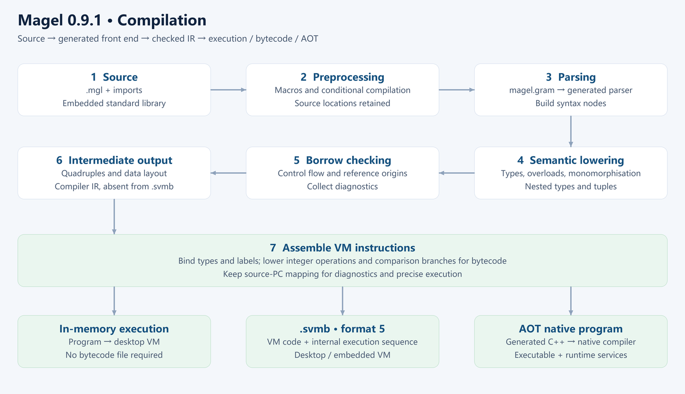
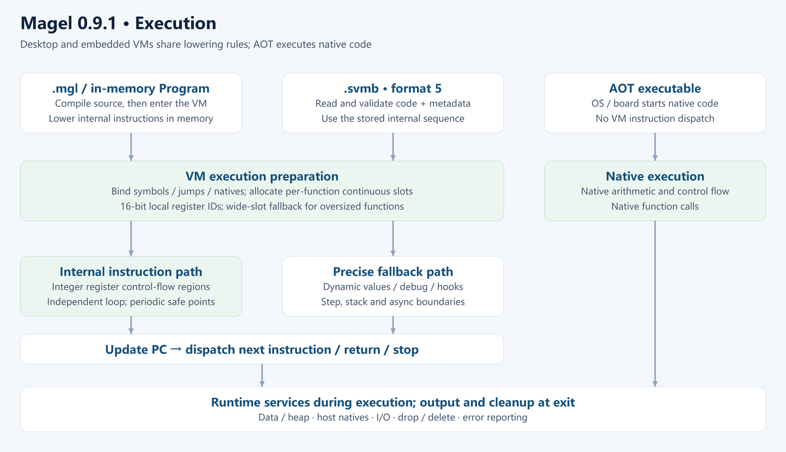

# The Magel Language

> **Write once, run anywhere.**
> One logic, from MCU to cloud; value semantics, non-null references, no GC.

Magel is a statically typed, value-semantics-first, GC-free general-purpose programming language
with borrow provenance and control-flow checks.
It borrows C's expression and block syntax, but types, ownership and runtime behavior are defined by
Magel itself, targeting the case where *one* program runs from the desktop all the way down to an
embedded board.

The Magel compiler's front end is generated from this repository's `source/magel.gram` by
[ParseEngine](https://github.com/rabbitc999/ParseEngine). It lowers `.mgl` source into StackVM
quadruples and then assembles VM instructions. Programs can execute in memory, be saved as
`.svmb` bytecode, or be exported as standalone deployable C++ programs.

> This is the English edition. The Chinese edition is the default and is the one maintained first —
> see [中文 README](README.md). Where the two disagree, the Chinese one wins.

See [current capabilities](doc/en/17-capabilities.md) for implemented features, defaults and platform limits; read the current version from [`VERSION`](VERSION).

## Compilation

It completes type checking, generic monomorphisation and an independent borrow
check before emitting quadruple IR and assembling VM instructions. The `.svmb` format 5
stores VM instructions, a lowered internal execution sequence and required metadata; it contains
no quadruple text. Older bytecode must be recompiled.



## Execution

Source execution and bytecode execution enter the same VM. After binding symbols and entry
points and allocating continuous slots per function, an independent integer register core runs
arithmetic, copies, branches, integer memory access, bounds checks and argument passing within each region.
Memory operations use existing validation services; calls reuse small returned frames. Other complex
operations use existing runtime services.
Debugging, dynamic values and precise execution boundaries use the base
instruction path. AOT programs execute native machine code with the corresponding runtime services.

`std::watchdog` gains a time dimension: after `enableTimeout*`, a full timeout period without
`kick()` turns into one soft-restart request on the same recovery channel as the memory watermark;
the time dimension is off by default and a non-positive timeout returns `Err(InvalidTimeout)` —
see the [library API reference](doc/library/std-watchdog.md).



The diagrams are generated by [`tools/make_pipeline_diagrams.py`](tools/make_pipeline_diagrams.py).
Run `python tools/make_pipeline_diagrams.py` to regenerate both PNG and SVG editions in both languages.

## Documentation

[Current capabilities and limits](doc/en/17-capabilities.md) describe implementation, defaults and platform contracts.

The [library API reference](doc/library/README.md) (Chinese) covers the module list with signatures, overloads, parameters, return values, error contracts and runnable examples.


| Document | Audience | What it covers |
| --- | --- | --- |
| [Documentation index](doc/en/README.md) | Everyone | Jump to any of the documents below by "what do you want to do" |
| [00 Vision](doc/en/00-vision.md) | Decision makers, prospective users | The three dilemmas of software delivery and Magel's answers, including "who should not use it" |
| [01 Quickstart](doc/en/01-quickstart.md) | First-time users | Install, first program, command cheat-sheet |
| [02 Language tour](doc/en/02-language-tour.md) | Experienced developers | 14 runnable snippets walking through what Magel looks like |
| [03 Core concepts](doc/en/03-core-concepts.md) | Users going deeper | Value semantics, non-null references, resource management without a GC |
| [04 Language reference](doc/en/04-language-reference.md) | Day-to-day writers | Syntax, semantics and common errors by topic |
| [05 Delivery security](doc/en/05-delivery-security.md) | Teams shipping outward | Four delivery forms, the four steps, reverse-engineering cost, boundary statement |
| [06 Cross-platform deployment](doc/en/06-deployment.md) | People doing deployment | Three execution modes, desktop / embedded / server, memory and watchdog |
| [07 Standard library overview](doc/en/07-stdlib-overview.md) | Anyone asking "what can it do" | standard-library modules by capability |
| [08 Host integration and C ABI](doc/en/08-host-integration.md) | Integrators | `abi` blocks, host glue bindings, type mapping, nullable references |
| [09 Toolchain](doc/en/09-toolchain.md) | Daily `magel` users | Scenario commands, options, `magel.toml`, diagnostics, debugging |
| [10 Roadmap](doc/en/10-roadmap.md) | Contributors, long-term users | Short/mid/long-term goals and "things we explicitly will not do" |
| [99 The Magel story](doc/en/99-magel-story.md) | Anyone curious how it got here | From Magic-C to Magel: which walls it hit, what it deleted, what is still unfinished |

Companion resources:

- [`example/samples/`](example/samples/) — runnable formal samples; expected stdout in [`example/expected/`](example/expected/).
- [`example/samples-error/`](example/samples-error/) — samples expected to fail; diagnostics in [`example/expected-error/`](example/expected-error/).
- [`doc/examples/`](doc/examples/) — examples that need a companion project layout (ABI, SQLite, svmb, GUI).
- [Full grammar reference (EBNF)](doc/14-grammar-ebnf.md) — the authoritative form of the grammar.

The 36 old developer-facing chapters have been removed; the 7 that are standalone specs
([14 EBNF](doc/14-grammar-ebnf.md)–[20 memory allocator](doc/20-memory-allocator.md)) moved into `doc/`
and were rewritten in the current voice. The rest remain in Git history.

Only the prose is translated: **code snippets are kept verbatim**, including their Chinese comments.
Every snippet in the documentation is executed before it is published, and the checking scripts
(`tmp/{tour,core,ref}_check.sh`) generate those snippets from heredocs inside the script —
translating the comments would break the correspondence and weaken that promise.
Not translated: the 7 low-level spec pages (`doc/14-grammar-ebnf.md`–`doc/20-memory-allocator.md`) and `doc/examples/`.

## Build

From the repository root:

```sh
sh gen.sh          # generate the parser first; requires ParseEngine
make               # build magel and build/magel-frontend/libparser.a
./magel example/samples/hello.mgl
sh check.sh        # run the passing and the failing samples
```

After cloning, run `sh gen.sh` with ParseEngine available, then `make`. Parser sources
(`magel_parser.cpp` / `magel_parser.hpp` / `magel_parser_user.h` / `magel_main.cpp`) are
generated locally and are not committed to the repository.

Regenerate for the initial build and after changing these source files; commit the sources,
not the generated parser files:

```sh
sh gen.sh          # regenerate the front end from magel.gram with IELR (needs the [ParseEngine](https://github.com/rabbitc999/ParseEngine) grammar generator)
```

- `source/magel.gram` / `source/magel_token.gram` (the grammar)
- `source/magel_epilogue.cpp` / `source/epilogue/*.cpp` (expanded into `magel_parser.cpp` by `%epilogue include`)
- `source/magel_driver.cpp` (expanded into `magel_main.cpp` by `%main include`)

> Forgetting `gen.sh` is the easiest trap to fall into: `magel_main.cpp` is a **generated copy** of
> `source/magel_driver.cpp`, and `make` alone does not regenerate it — you will see "I changed it but
> nothing happened".

`gen.sh` needs a ParseEngine grammar generator. The simplest option is to drop it into the
repository root as `./ParseEngine[.exe]`; it also works if it stays in a neighboring ParseEngine
checkout (`gen.sh` looks for `../ParseEngine/build/bin/` automatically).

### Building with annotations and reflection

The default toolchain build includes annotation and reflection support in both the front end
and the VM runtime:

```sh
make                # defaults to MAGEL_WITH_REFLECTION=1 STACKVM_WITH_REFLECTION=1
make reflection     # retained as an explicit enable target
```

Both the front end (`MAGEL_WITH_REFLECTION`) and the runtime (`STACKVM_WITH_REFLECTION`) must be
enabled; if either is missing, `--reflection` reports a missing macro. After that `--reflection`
works, and `--no-reflection` turns it off explicitly.

With reflection support built in, source compilation emits reflection metadata and its artifact
feature flag by default. Explicitly use `--no-reflection` when targeting a board VM without
reflection support. To test a trimmed toolchain, explicitly build with
`make MAGEL_WITH_REFLECTION=0 STACKVM_WITH_REFLECTION=0`.

## Quick usage

```sh
./magel run  example/samples/hello.mgl        # interpret (default)
./magel svmb example/samples/hello.mgl --out ../tmp/hello   # emit .svmb
./magel aot  example/samples/hello.mgl --out ../tmp/hello --opt-level=2
./magel new  hello-magel                       # create a new application project
```

`magel` is the single toolchain entry point: front end, both C/C++ export tiers, project generation
and cleanup all live in the same program. See [Toolchain](doc/en/09-toolchain.md) for the remaining
subcommands and `--mode`.

### Debugging

The compiler itself is the debug adapter:

```sh
./magel --dap example/samples/hello.mgl     # speak DAP over stdio, for editors to attach
```

With the extension under `vscode/` installed, pick **Magel** in "Run and Debug" and you can set
breakpoints directly in `.mgl` files (the extension launches `magel --dap <file>`). Breakpoints,
continue, step in / over / out and the call stack are supported; program output arrives through
`output` events in the debug console. The variables panel is still empty (the VM has no interface
for reading stack-frame slots yet).

### Diagnostics

Syntax errors carry **file, line and column**, echo the offending line, and underline it at the
error position with a caret run sized to the token:

```text
syntax error: example/samples-error/syntax_extern_impl_removed.mgl line 2 col 8: expected one of identifier / constant(const) / mutable(mut) / new(new) (17 candidates), found impl(impl)
   |
 2 | extern impl Value : Some = binding;
   |        ~~~~
```

- The width of the underline is the length of the offending token; tabs are padded to 4-column tab
  stops and CJK characters count as 2 columns, so the column never drifts.
- When the error sits in a file pulled in by `%include`, it points at **the file that actually
  contains the mistake**, not at the expanded main file.
- Internal token names are no longer shown: `SEMI` → `semicolon(;)`, `IMPL` → `impl(impl)`,
  `VARIABLE` → `identifier`.
- Diagnostic text follows the display language (`MAGEL_LANG=zh|en|ja` or `--lang`); the same error
  reads:

  ```text
  期望 标识符 / 常量(const) / 可变(mut) / 新建(new) 等 17 个之一，实际是 实现(impl)
  expected one of identifier / constant(const) / mutable(mut) / new(new) (17 candidates), found impl(impl)
  識別子 / 定数(const) / 可変(mut) / 生成(new) 他 17 件のいずれかを期待しましたが、実際は 実装(impl) です
  ```

  Semantic errors (type mismatch, undefined symbol, …) are still Chinese for now — those messages
  live in the compiler core, not in the diagnostic presentation layer.

## Language tour

```c
struct Item { int64 value; };

int64 main() {
    List<Item> items;
    Item item;
    item.value = 7;
    items.push(item);
    println("{}", items.len());
    return 0;
}
```

Value semantics is the default: assignment, argument passing and return all copy; share explicitly
by taking a reference (`T const&` read-only, `T mut&` writable), and there are no pointers and no
address arithmetic. There is no GC, so resources are released deterministically when they leave
scope. The standard library ships containers, iterators, JSON/TOML, regex, paths and processes,
networking, SQL, linear algebra, concurrency and more — see
[Standard library overview](doc/en/07-stdlib-overview.md).

## Configuration

A project can set the run mode, compiler path and search directories in `magel.toml`; command-line
arguments win. Example:

```toml
[magel]
run = "interpret"
opt_level = 2
main = "src/main.mgl"
```

`[magel] main` names the project's entry file: when you run **without** a source file it is used as
the entry point (i.e. build the project); when you pass a file explicitly it is a single-file
compilation and the main file is ignored. Projects generated by `magel new` carry this line by
default.

## Embedded mode

Enable it in `magel.toml`:

```toml
[embedded]
enabled = true
restrict_modules = ["std::math"]     # added on top of the built-in denylist
max_memory = 1048576                   # runtime memory ceiling (bytes)
```

- **The gate is at compile time**: importing a denied module is a compile error (with source
  location). The built-in denylist is `std::net` / `std::process` / `std::sql` / `std::io` /
  `std::thread` / `std::coroutine` / `std::concurrency` (the fixed front-end profile blocklist); `restrict_modules` only **adds** to it.
- **One shared VM core**: `[embedded]` controls the front-end module gate and memory ceiling. A standalone MCU host additionally selects build macros, pools and glue. Command-line `--memory-size` takes precedence.
- The artifact is still an ordinary `.svmb`, and the `vscode/` extension already recognizes that
  file type.

## Repository layout

```text
magel/
├── magel.gram / magel_token.gram   grammar: token declarations and productions
├── gen.sh / Makefile               build and self-checks
├── std/lang.mgl            core library; collections and reflection live in std/
├── magel_*.hpp / magel_*.cpp       compiler front end and driver
├── glue/                           host-side C++ glue
├── stackvm/                        StackVM interpreter
├── magel-emit/                     tool that exports standalone C++ programs
├── magel-generator/                entry point that generates standalone compiler projects
├── doc/                            user-facing documentation (00–20, 99)
│   ├── en/                         English edition (index + 00–11, 13, 99; 15 files)
│   └── library/                    library API reference (one page per module)
├── example/                        examples (samples, error samples, web-students, …)
├── tests/                          Python acceptance scripts
├── tools/                          helper scripts (icon, overview figure, …)
├── stackvm_mcu/                         board-oriented VM branch
├── gui/                            cross-platform GUI example
└── sql-magel/                      student information management sample project
```

Full details live in the README of each directory and in the [documentation](#documentation)
section above.

## License

MIT, see `LICENSE`.


Generated parser sources, headers and reports live in `source/`. Object files and the parser archive live in `build/magel-frontend/`, keeping the repository root clear.
