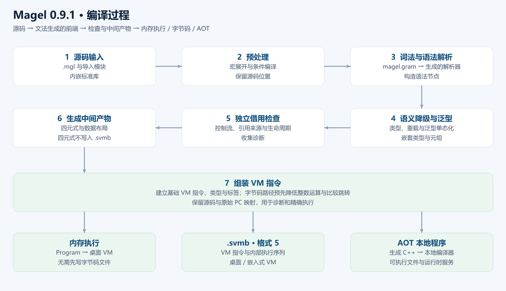
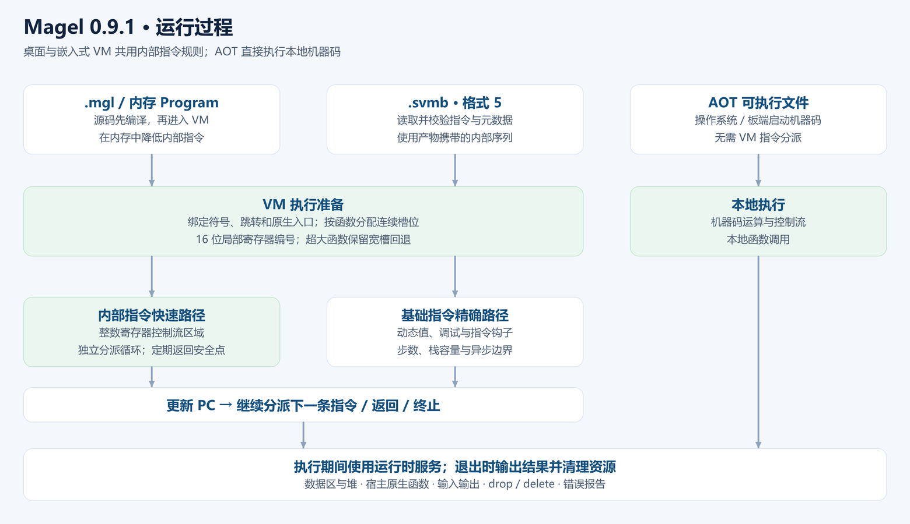

# Magel 语言

> **一次编写，处处运行。**
> 一份逻辑，从 MCU 到云端；值语义、非空引用、无 GC。
>
> <sub>Write once, run anywhere. · 一度書けば、どこでも動く。</sub>

**中文（默认）** · [English](README.en.md)

Magel 是一门静态类型、值语义优先、不带 GC 的通用编程语言，提供借用来源与控制流检查。它借用 C 的表达式与块语法，但类型、所有权与运行时行为由 Magel 自行定义，面向"同一份程序从桌面一直到嵌入式板端"的场景。

Magel 编译器由本仓库的 `source/magel.gram` 经 [ParseEngine](https://github.com/rabbitc999/ParseEngine) 生成前端，把 `.mgl` 源码降级为 StackVM 四元式，再组装为 VM 指令。程序可在内存中执行、保存为 `.svmb` 字节码，或导出为可独立部署的 C++ 程序。

当前已实现能力、默认配置与平台边界统一见[能力说明](doc/17-capabilities.md)，版本以 [`VERSION`](VERSION) 为准。

## 编译过程

类型检查、泛型单态化与独立借用检查完成后，编译器生成四元式中间产物，再组装 VM 指令。
`.svmb` 保存 VM 指令、预先降低的内部执行序列及必要元数据；四元式文本不进入字节码文件。



## 运行过程

源码执行和字节码执行最终进入同一套 VM：绑定符号与入口、按函数分配连续槽位后，
进入独立整数寄存器核心，连续执行区域内的运算、复制、跳转、整数内存访问、下标检查与参数传递；
内存访问复用现有校验服务，函数调用复用已返回的小帧，其他复杂操作继续使用运行时服务。
调试、动态值或精确边界要求逐条执行时使用基础指令路径。
AOT 程序执行本地机器码，并使用相应的运行时服务。



配图由 [`tools/make_pipeline_diagrams.py`](tools/make_pipeline_diagrams.py) 生成，运行
`python tools/make_pipeline_diagrams.py` 可重建中英文 PNG 和 SVG。

## 文档

| 文档 | 面向 | 内容 |
| --- | --- | --- |
| [文档入口](doc/README.md) | 所有人 | 按「你想做什么」跳转到下面任意一篇 |
| [00 使命宣言](doc/00-vision.md) | 决策者、潜在用户 | 软件交付的三重困境与 Magel 的回答，含「不适合谁」 |
| [01 快速开始](doc/01-quickstart.md) | 第一次用的人 | 安装、第一个程序、常用命令速查 |
| [02 语言速览](doc/02-language-tour.md) | 有经验的开发者 | 14 段可运行片段走一遍 Magel 长什么样 |
| [03 核心概念](doc/03-core-concepts.md) | 准备深入使用的人 | 值语义、非空引用、无 GC 的资源管理 |
| [04 语言参考](doc/04-language-reference.md) | 日常写代码的人 | 按主题查阅语法、语义与常见错误 |
| [05 交付安全](doc/05-delivery-security.md) | 需要对外交付的团队 | 四种交付形态、四步法、逆向成本与边界声明 |
| [06 跨平台部署](doc/06-deployment.md) | 做部署的人 | 三种执行方式、桌面 / 嵌入式 / 服务端、内存与看门狗 |
| [07 标准库概览](doc/07-stdlib-overview.md) | 想知道「能做什么」的人 | 标准库模块按能力域速查 |
| [库函数 API 参考](doc/library/README.md) | 查阅库 API 的人 | 模块的声明、重载、参数、返回值、错误边界与完整示例 |
| [08 宿主集成与 C ABI](doc/08-host-integration.md) | 做集成的人 | `abi` 块、宿主胶水绑定、类型映射、可空引用 |
| [09 工具链使用](doc/09-toolchain.md) | 日常用 `magel` 的人 | 场景指令、选项、`magel.toml`、报错呈现、调试 |
| [17 当前能力](doc/17-capabilities.md) | 评估与集成人员 | 实现能力、默认配置、宿主/板端及工具边界 |
| [10 路线图](doc/10-roadmap.md) | 贡献者、长期用户 | 短中长期目标与「明确不做的事」 |
| [99 Magel 的故事](doc/99-magel-story.md) | 好奇这门语言怎么来的人 | 从 Magic-C 到 Magel：撞过哪几次墙、删掉了什么 |

**英文版**：[`doc/en/`](doc/en/README.md) 维护对应的功能说明；未提供完整译文的底层规格从英文入口链接中文版。

- 中文说明优先维护，中英文共有的代码片段保持一致。
- 当前能力与默认配置见中英文能力页；标准库目录以 API 索引为准。
- 本文件、`README.en.md` 和 `doc/README.md` 提供语言切换入口。

配套资源：

- [`example/samples/`](example/samples/) —— 可运行的正式样例，标准输出在 [`example/expected/`](example/expected/)。
- [`example/samples-error/`](example/samples-error/) —— 预期报错的样例，诊断文本在 [`example/expected-error/`](example/expected-error/)。
- [`doc/examples/`](doc/examples/) —— 需要配套工程布局的示例（ABI、SQLite、svmb、GUI）。
- [完整语法参考（EBNF）](doc/14-grammar-ebnf.md) —— 文法的权威形式。

旧的开发者向 36 章已删除，其中属独立规格的 7 篇（[14 EBNF](doc/14-grammar-ebnf.md)–[20 内存分配器](doc/20-memory-allocator.md)）
迁入 `doc/` 并改写为当前口径，其余见 Git 历史。

## 构建

在项目根目录执行：

```sh
sh gen.sh          # 首次构建先生成解析器，需要 ParseEngine 文法生成器
make               # 构建 magel 与 build/magel-frontend/libparser.a
./magel example/samples/hello.mgl
sh check.sh        # 运行正常与错误样例
```

首次构建先执行 `sh gen.sh`，再执行 `make`。解析器源码（`magel_parser.cpp` /
`magel_parser.hpp` / `magel_parser_user.h` / `magel_main.cpp`）是生成物，不纳入版本管理。

首次构建以及修改下面这些真源后需要重新生成；提交真源，不提交解析器生成物：

```sh
sh gen.sh          # 用 IELR 从 magel.gram 重新生成前端（需要 [ParseEngine](https://github.com/rabbitc999/ParseEngine) 文法生成器）
```

- `source/magel.gram` / `source/magel_token.gram`（文法）
- `source/magel_epilogue.cpp` / `source/epilogue/*.cpp`（`%epilogue include` 展开进 `magel_parser.cpp`）
- `source/magel_driver.cpp`（`%main include` 展开进 `magel_main.cpp`）

> 忘了跑 `gen.sh` 是最容易踩的坑：`magel_main.cpp` 是 `source/magel_driver.cpp` 的**生成副本**，
> 只 `make` 不会重新生成它，于是你会看到"改了没生效"。

`gen.sh` 需要一份 ParseEngine 文法生成器。最省事是把它放到项目根目录 `./ParseEngine[.exe]`；
也可以让它待在旁边的 ParseEngine 仓库里（`gen.sh` 会自动找 `../ParseEngine/build/bin/`）。

### 编入注解与反射

默认构建同时编入注解与反射前端、VM 运行时支持：

```sh
make                # 默认 MAGEL_WITH_REFLECTION=1 STACKVM_WITH_REFLECTION=1
make reflection     # 保留的显式启用入口
```

前端（`MAGEL_WITH_REFLECTION`）与运行时（`STACKVM_WITH_REFLECTION`）必须同时开启，缺一个 `--reflection` 就报缺宏。之后 `--reflection` 生效，`--no-reflection` 可显式关闭。

工具链编入反射能力后，单次源码编译默认生成反射元数据及对应产物特征位。
交付到未编入反射的板端 VM 时，必须使用 `--no-reflection` 显式关闭。
验证裁剪配置时可显式执行 `make MAGEL_WITH_REFLECTION=0 STACKVM_WITH_REFLECTION=0`。

## 快速使用

```sh
./magel run  example/samples/hello.mgl        # 解释运行（默认）
./magel svmb example/samples/hello.mgl --out ../tmp/hello   # 生成 .svmb
./magel aot  example/samples/hello.mgl --out ../tmp/hello --opt-level=2
./magel new  hello-magel                       # 新建应用工程
```

`magel` 是统一工具链入口：前端、两档 C/C++ 导出、工程生成与清理都在同一程序里。更多子命令与 `--mode` 见 [工具链使用](doc/09-toolchain.md)。

### 调试

编译器本体就是调试适配器：

```sh
./magel --dap example/samples/hello.mgl     # 按 DAP 在 stdio 上收发，供编辑器接入
```

VS Code 装了 `vscode/` 下的插件后，在「运行与调试」里选 **Magel** 即可直接在 `.mgl` 上打断点
（插件拉起 `magel --dap <文件>`）。支持断点、继续、步进 / 步过 / 步出与调用栈；程序输出走
`output` 事件显示在调试控制台。变量面板暂为空（VM 还没有读栈帧槽的接口）。

### 报错

语法错误给到**文件、行号、列号**，并回显出错那一行、按出错位置的长度画波浪号：

```text
语法错误：example/samples-error/syntax_extern_impl_removed.mgl 第 2 行第 8 列：期望 标识符 / 常量(const) / 可变(mut) / 新建(new) 等 17 个之一，实际是 实现(impl)
   |
 2 | extern impl Value : Some = binding;
   |        ~~~~
```

- 波浪号的宽度就是出错 Token 的长度；制表符按 4 列制表位铺平，中文按 2 列算，所以列不会歪。
- 出错位置落在 `%include` 进来的文件里时，指向**真正写错的那个文件**，不是展开后的主文件。
- 不再显示 Token 内部名：`SEMI` → `分号(;)`、`IMPL` → `实现(impl)`、`VARIABLE` → `标识符`。
- 报错文案跟随显示语言（`MAGEL_LANG=zh|en` 或 `--lang`），同一处错误分别为：

  ```text
  期望 标识符 / 常量(const) / 可变(mut) / 新建(new) 等 17 个之一，实际是 实现(impl)
  expected one of identifier / constant(const) / mutable(mut) / new(new) (17 candidates), found impl(impl)
  ```

  语义错误（类型不匹配、未定义符号等）目前仍是中文——那些文案写在编译器核心里，
  不在报错呈现层。

## 语言速览

```c
struct Item { int64 value; };

int64 main() {
    List<Item> items;
    Item item;
    item.value = 7;
    items.push(item);
    println("{}", items.len());
    return 0;
}
```

值语义是默认：赋值、传参、返回都复制；要共享就显式取引用（`T const&` 只读、`T mut&` 可写），没有指针与地址算术。没有 GC，资源在离开作用域时确定性释放。标准库自带容器、迭代器、JSON/TOML、正则、路径与进程、网络、SQL、线性代数、并发等，详情见 [标准库概览](doc/07-stdlib-overview.md)。

## 配置

项目可用 `magel.toml` 设置运行方式、编译器路径与搜索目录；命令行参数优先。示例：

```toml
[magel]
run = "interpret"
opt_level = 2
main = "src/main.mgl"
```

`[magel] main` 指定工程主文件：**不给源文件**执行时用它当入口（即构建项目）；
命令行显式给了文件就是单文件编译，不看主文件。`magel new` 生成的工程默认带这一行。

## 嵌入式模式

在 `magel.toml` 里开启：

```toml
[embedded]
enabled = true
restrict_modules = ["std::math"]     # 在内置禁用之外再追加
max_memory = 1048576                   # 运行内存上限（字节）
```

- **门禁在编译期**：程序 import 了被禁模块就直接编译报错（带源码位置）。内置禁用
  `std::net` / `std::process` / `std::sql` / `std::io` / `std::thread` / `std::coroutine` /
  `std::concurrency`（前端此配置固定禁用的模块），`restrict_modules` 只做**追加**。
- **同一 VM 核心**：`[embedded]` 配置控制前端模块门禁与内存上限；独立 MCU VM 另外由构建宏、内存池与宿主胶水决定实际能力。命令行 `--memory-size` 优先于配置。
- 产物仍是普通的 `.svmb`，`vscode/` 插件已能识别该文件类型。

## 目录结构

```text
magel/
├── magel.gram / magel_token.gram   文法：词法声明与产生式
├── gen.sh / Makefile               构建与自测
├── std/lang.mgl            核心库；集合与反射位于 std/
├── magel_*.hpp / magel_*.cpp       编译器前端与驱动
├── glue/                           宿主侧 C++ 胶水
├── stackvm/                        StackVM 解释器
├── magel-emit/                     导出独立 C++ 程序的工具
├── magel-generator/                生成独立编译器工程的入口
├── doc/                            面向使用者的文档（00–20、99）
│   ├── en/                         英文版（入口 + 00–11、13、99，共 15 篇）
│   └── library/                    库函数 API 参考（按模块分页）
├── example/                        示例（samples、错误样例、web-students 等）
├── tests/                          Python 验收脚本
├── tools/                          图标与总览图等辅助脚本
├── stackvm_mcu/                         面向板端的虚拟机分支
├── gui/                            跨平台 GUI 示例
└── sql-magel/                      学生信息管理示例工程
```

完整说明见对应目录下的 README 与上面的[文档](#文档)章节。

## 许可证

MIT，见 `LICENSE`。


解析器生成源码、头文件与报告统一位于 `source/`；对象文件与解析器静态库位于 `build/magel-frontend/`，不会散落到仓库根目录。
