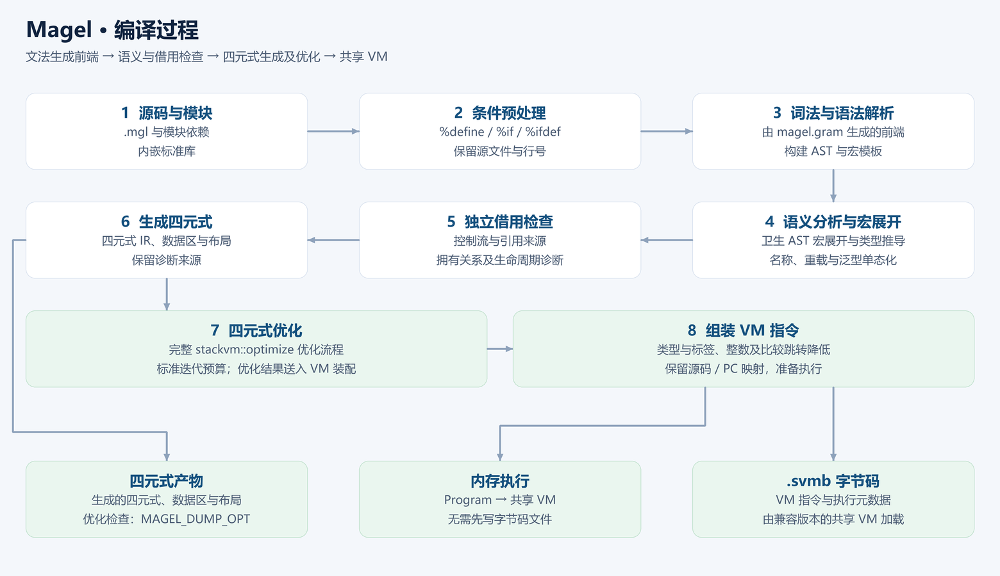
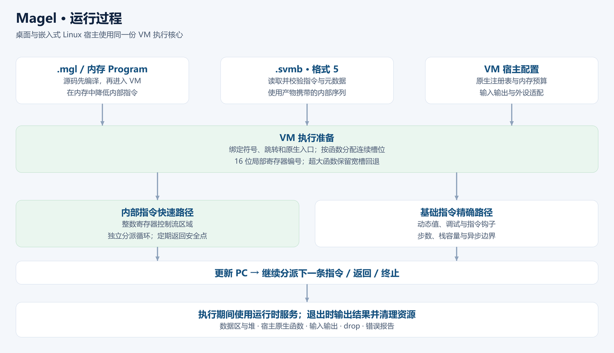

# 第 1 章 第一个程序

> **ChaLi 是哪五个字母** —— 每个字母锁一条契约，记住了后面每章都能对上号：
>
> - **C — Copy（深拷贝值语义）**：赋值就是彻底的复制，绝不共享内存。大对象必须显式用引用传。
> - **H — Hygienic（卫生宏）**：在编译期做安全的代码替换，绝不意外捕获或污染外部变量。
> - **A — Any（万能盒子 / 类型擦除）**：没有泛型约束时，可以装下任何类型的数据。
> - **L — Lifetime（生命周期 / 借用检查器）**：引用永远不能活得比它的数据源更久，
>   否则编译直接报错（`CHL1204`）。
> - **I — Interface（接口 / 运行期多态）**：定义一组共同的“契约”，运行期根据对象的实际类型进行分派。
>
> 每条的判据与「什么算违反」见 [40 名称冻结：ChaLi 五个字母](../40-name-freeze.md)。

万事开头难，但这一章只干三件事：把工具装好、跑出一行字、看懂这行字是怎么来的。

读完这一章，你会有第一个能跑的程序，也会知道「出错」在 ChaLi 里长什么样——
后者比前者重要，因为接下来每一章你都会用到它。

---

## 1.1 把工具装好

ChaLi 只有**一个**命令行程序，叫 `chali`，解释、编译、建工程、跑测试全在它里面。
装它有两条路。

**这条路最短：用发布包。** 拿到 `dist/chali-<版本>-<平台>-<架构>.tar.gz`，解开，
把里面的 `bin/` 加进 PATH，就完事了。

**这条路最全：从源码构建。** 适合想改编译器的人，也适合想看清内部的人：

```sh
sh gen.sh      # 用 IELR 从 chali.gram 生成前端
make           # 构建 chali 与 libparser.a
```

`gen.sh` 需要一份 [ParseEngine](https://github.com/rabbitc999/ParseEngine) 文法生成器，
细节见[快速开始](../../doc/01-quickstart.md#1-安装)，这里不展开。

装完了，敲一句：

```sh
chali help
```

屏幕上滚出一大串用法，就说明装好了。**先别急着读完那串帮助**——那是给有经验的人查的，
跟着这本书走，你会一个个认识里面的选项。

> **Windows 用户注意**：程序名是 `ChaLi.exe`。在 Git Bash / MSYS 里写 `./chali`
> 能自动找到 `ChaLi.exe`；光写 `chali` 会去 PATH 里找，可能找到的不是你当前目录这一份。
> 本书后文一律写 `chali`，你自己敲的时候按环境补上 `./`。

---

## 1.2 Hello, ChaLi

新建一个文件 `hello.chl`，内容如下：

```chali
void main()
{
    println("Hello, ChaLi!");
}
```

```text
Hello, ChaLi!
```

然后运行它：

```sh
chali run hello.chl
```

屏幕上出现 `Hello, ChaLi!`，第一个程序就成了。

`chali run` 这个写法看着啰嗦，其实 `run` 是可以省的——直接

```sh
chali hello.chl
```

效果一样。但本书会一直写 `chali run`，因为**把场景写出来**在人多的时候少很多误会：
`chali hello.chl Alice` 和 `chali run hello.chl Alice` 是同一件事，
但 `chali check hello.chl` 完全是另一件事。

---

## 1.3 逐行看懂它

就三行，一行一行来。

**第一行：`void main() {`**

程序从哪里开始跑？从 `main` 开始。这个名字是**定死的**，不能改成 `Main`、`start`
或者别的什么。前面的 `void` 是它返回的东西的类型，`()` 里现在空着，意思是它不接收参数。

**第二行：`println("Hello, ChaLi!");`**

`println` 是「打印一行」的意思：把括号里的东西写到屏幕上，末尾自动换行。
它是 ChaLi 核心库里最常用的函数，不用 `import` 就能用。

行尾那个 `;` 是分号，表示**这句话说完了**。跟 C、Java 一样。

**最后的花括号 `}`** 是 `main` 的结尾。

看出来了吗——花括号划范围，分号断句，这和 C 系语言一模一样。
这是 ChaLi **刻意**这么做的：你已经会的东西，它不想让你重学一遍。

---

## 1.4 `run` 和 `check`

现在故意把程序弄坏一次，看看会发生什么。把第二行末尾的分号删掉：

<!-- fail -->
```chali
void main()
{
    int64 x = 1

}
```

再跑：

```text
语法错误：hello.chl 第 3 行第 5 列：期望 条件(if) / 自增(++) / 自减(--) / 加号(+) 等 44 个之一，实际是 返回(return)
 3 |     return 0;
   |     ~~~~~~
```

三件事值得注意：

- 它告诉你**第 3 行第 5 列**，还把出问题的那段源码抄给你、底下画上波浪线。
  第 1 行少了个分号，报的却是第 3 行——这是**解析器在往后看**：它读完第 2 行
  还在等一个分号，结果等来了 `return`，于是「在 `return` 这里」断了。
  看到报错位置和你以为的不一致时，先看**报错位置的前面**。
- 内部记号名被翻译成了人话：`条件(if)`、`返回(return)`。你没看错，就是中文。
  报错语言跟着系统走，可以用 `chali lang en` 或环境变量 `CHALI_LANG` 换掉。
- 那句「等 44 个之一」说了它在等什么。这种话现在看不懂没关系，
  以后你写多了，一眼就知道是「这里少了个东西」。

**重要**：这个错误是**编译期**就报出来的，程序一个字符都没执行。
这就是 ChaLi 和其他很多语言不同的地方——**能编译期拦住的，绝不放到运行期**。

如果你只想检查代码写没写对、不想真的跑它，用：

```sh
chali check hello.chl
```

`check` 做前两步（预处理、解析与类型检查），不执行、也不产出文件。
写代码的时候这个命令用得比 `run` 还多：**先 check 再 run**，
能省掉很多「跑到一半才发现写错了」的时间。

> 还有个更细的用法：`chali check hello.chl json`，输出机器可读的 JSON 诊断。
> 这是给编辑器插件用的，平时不用管。

---

## 1.5 那行字背后发生了什么

`chali run` 看着像「执行脚本」，其实它在一个进程里做完了四件事：

1. **预处理** —— 处理 `%define`、`%if` 这类指令（第 19 章讲）；
2. **解析与类型检查** —— 语法、类型、引用的生命周期都在这里查，不通过就不执行；
3. **降级为四元式** —— 把程序翻译成虚拟机认识的中间表示；
4. **解释执行** —— 在当前进程里跑起来。

前三步就是「编译」，第四步才是「执行」。把 `run` 换成别的场景词，
前三步是一样的，只是最后一步换了形态：

| 你想 | 命令 |
| --- | --- |
| 直接跑起来 | `chali run src/main.chl` |
| 只检查、不跑 | `chali check src/main.chl` |
| 导出字节码 `.svmb` | `chali svmb src/main.chl out build/app` |

这三条路的区别在第 22 章讲；现在你只要知道：**同一份源码，可以有好几种走法**。

---

## 1.6 从源码到虚拟机：两张流程图

先看编译流程。条件预处理决定哪些代码参与编译；文法生成的词法与语法前端建立 AST，宏模板也在其中。卫生宏在语义分析时展开，并与类型推导配合，之后完成名称、类型、泛型和借用检查。



四元式是本书所说的 IR。编译器先生成四元式、数据区和布局，供检查或后续装配；执行路径对四元式进行完整优化，再组装 VM 指令。图中的四元式产物出口位于生成阶段，优化结果可通过调试输出检查，二者不要混淆。

再看运行流程。源码运行和字节码运行最终都进入同一套共享 VM。执行准备绑定入口和宿主服务，运行时按指令操作数据、调用原生服务，并处理预算、错误与资源清理。



寄存器核心、融合与其他优化属于 VM 内部实现；调试和精确边界按需要使用相应路径。使用者先关注输入、输出和错误，不必在第一章记住所有实现名词。资源与作用域见第 8 章，实际部署边界见第 22 章。

两张图与仓库 README 使用相同绘图脚本生成。内嵌手册导出时携带图片，PDF 也直接收录图片，所以离线阅读不依赖网络。

## 1.7 小结

这一章你认识了：

- 入口函数固定叫 `main`，返回 `int64` 或 `void`；`void main` 正常完成时退出码为 0，panic 仍失败；
- `println(...)` 打印一行，来自核心库，不用 import；
- 分号断句、花括号划范围，和 C 系语言一样；
- `chali run` 跑，`chali check` 只查；
- 报错会给出**行列位置**和**画了波浪线的源码**，而且大多在编译期就报出来了。

还有一件事本章没讲：`println` 为什么不用 `import`？因为它属于**核心模块 `lang`**，
而 `lang` 是自动加载的。别的模块就没这个待遇了，第 18 章会讲清楚。

---

## 1.8 下一步

光看「Hello, ChaLi」是学不会编程的。下一章我们写一个**真的有用**的小程序：
键盘猜数字。它会用到变量、输入、循环和分支——四个最基础的积木，
而且你会看到它们是怎么串在一起的。

翻到[第 2 章 猜数字](02-猜数字.md)。

## 1.9 边界与验证

通过语法和类型检查，只能证明对应静态检查通过。程序是否产生预期输出、是否访问了外部资源，需要运行验证；外部输入变化也可能使后续运行失败。

## 1.10 习题

前两题用于理解和基本实现，第三题检查边界，最后一题为综合挑战。先独立完成，再核对参考解答。

1. 解释检查成功与运行结果正确之间的区别。
2. 把欢迎程序改为输出两行，分别为自己的名字和 Hello, ChaLi!。
3. 删掉语句末尾的分号，检查诊断位置，再修复。
4. 挑战：写出一个检查成功、运行时断言失败的完整程序。

### 参考解答与验收要点

1. 检查不执行全部业务路径；运行时还可能发生断言、输入或宿主错误。至少分别记录检查状态、退出状态和实际输出。
2. 使用两次 println，逐行对照输出；不要把编辑器显示的文字当成程序输出。
3. 这是语法错误练习，应在检查阶段失败。记录文件、行列和具体缺失内容，不把整条诊断文案写死。
4. 在 main 内调用 assert(false)，检查成功但执行失败；将它作为故意失败用例单独保存。

## 1.11 番外：皇帝的新程序

改编自安徒生《皇帝的新装》，以下为编程主题的独立改写。

皇帝最爱新程序，早朝先问今日添了几个功能。两个裁缝进宫，说能编出天下最快的程序，只有不称职的大臣看不见运行结果。

老臣奉命验收，看见屏幕空空，心中一惊。他问裁缝为何没有输出。裁缝指着一页没有错误的检查记录：“只有懂编译的人才看得出。”老臣便在验收书上写了“运行极快”。

第二位大臣更谨慎，亲眼看见源码通过检查，才回去报告：“臣已确认，全无错误。”他没有按下运行键，怕显得自己不懂。

游行那天，皇帝抱着空屏幕走过大街。百姓都赞叹程序的速度；一个孩子问：“它究竟做了什么？”人群渐渐安静。皇帝叫人运行，屏幕这才显出第一行字。他想停下游行，可仪仗已经走到了街口，大臣们仍举着写有“验收通过”的牌子。

### 技术对照

通过语法和类型检查，只能证明对应静态检查通过。程序是否产生预期输出、是否访问了外部资源，需要运行验证；外部输入变化也可能使后续运行失败。
