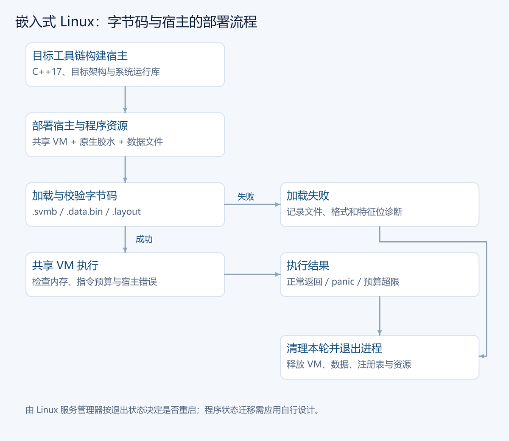

# 第 22 章 交付与部署

Magel 程序通过 VM 执行。交付时，可以保留源码和编译器，也可以预先导出字节码并随宿主部署。

## 22.1 直接运行源码

```sh
magel run app.mgl
```

标准库内嵌在编译器中。实际使用的动态库、数据库、网络服务和外设仍需要部署环境提供。

## 22.2 导出字节码

```sh
magel svmb app.mgl out build/app
```

程序产物包括 `.svmb`、`.data.bin` 与 `.layout`。宿主校验字节码格式和特征位，加载数据，注册原生函数，然后通过 `stackvm::Machine` 执行。

四元式可通过 `magel emit app.mgl out build/app` 导出，用于检查或独立 VM 工具装配。四元式和字节码都不是宿主机器码。

## 22.3 嵌入宿主

桌面应用和嵌入式 Linux 宿主可以编译共享 VM，内嵌字节码及数据。宿主程序本身由 C/C++ 工具链构建，Magel 逻辑仍通过 VM 执行。

宿主负责程序、数据区、注册表、堆与输出接口的生命周期，检查执行退出状态、错误和活动资源。共享 VM 核心只有 `library/stackvm/` 一份，宿主按目标架构构建胶水和系统依赖。

## 22.4 预算、错误与恢复

VM 默认使用最高可用执行优化。桌面可配置步数与内存预算；嵌入式 Linux 按实际服务与内存容量设置预算。

看门狗支持可恢复终止及宿主重启；重启前必须清理 VM 所有权状态，不能把旧地址或闭包当成新程序中的有效对象。

## 22.5 符号压缩与程序更新

符号压缩降低符号表体积和可读性，不构成加密、防逆向或完整沙箱。交付时仍应按实际宿主权限控制文件、网络及外设能力。

程序更新替换字节码映像，不自动迁移运行中的栈、闭包和全局状态。先停止旧实例，清理资源，再装入匹配的数据和新程序。

## 22.6 命令边界

工具选项见[工具链](../09-toolchain.md)，宿主代码见[宿主集成](../08-host-integration.md)，目标宿主部署见[部署说明](../06-deployment.md)。

正文到这里结束。可以继续查看[常见错误速查](A-常见错误速查.md)与[标准库速查](B-标准库速查.md)。

## 22.7 目标宿主的实际验收

桌面和受支持的嵌入式 Linux 使用同一 VM 核心。目标需要 C++17 工具链及实际使用的操作系统宿主服务；不把某个 Linux 板子的验证扩展为裸机或单片机承诺。

部署前核对架构、VM 与字节码版本、动态库、工作目录、文件权限和资源预算。内嵌标准库不需要在目标机重新寻找 .mgl 文件，但程序自己的配置、数据库和其他外部资产仍需单独交付。

验收至少包含成功输入、非法输入、预算耗尽和正常退出。服务恢复由宿主进程管理和业务持久化共同设计：重启能恢复什么、哪些操作需要重试、是否可能重复写入，都要在应用层说明。保留原始诊断，不能只因进程重启便把失败记成成功。



## 22.8 边界与验证

可移植交付依赖受支持的 VM、产物版本与宿主服务。源码、四元式和字节码各有用途；原生外壳仍通过共享 VM 执行，不能把它描述为绕过 VM 的机器码后端。

## 22.9 习题

前两题用于理解和基本实现，第三题检查边界，最后一题为综合挑战。先独立完成，再核对参考解答。

1. 源码、四元式和字节码分别适合何种交付或检查？
2. 为一个依赖文件的程序列出最小交付清单。
3. 设计资源预算耗尽后的退出检查。
4. 挑战：在同一目标环境比较源码运行与字节码运行的结果。

### 参考解答与验收要点

1. 源码适合继续编译，四元式便于检查中间结果，字节码供相容 VM 加载；每种都需明确目标约定。
2. 包含程序产物、外部文件、宿主服务与路径约定，并在干净目录运行验证。
3. 保留错误信息，确认资源按协议清理，并区分可重启状态与需要人工处理的持久化问题。
4. 对照相同输入、输出、错误及资源状态，不只测一个成功样例。

## 22.10 番外：程序过关记

改编自《西游记》取经通关，以下为编程主题的独立改写。

唐僧把程序交给悟空，说在东土已经运行过，到了西天自会一样。第一关要看宿主服务，第二关核对字节码版本，第三关问内存预算。八戒嫌关文太多，拿出一张旧截图，证明当年输出过正确结果。

守关人并不否认截图，只问今天的目标环境是否提供相同约定。悟空将平台依赖逐项列出，能随产物交付的带上，需要宿主提供的明确登记，不能用愿望替代文件和服务。

到夜里，程序因预算停止。沙僧记下原始错误，按约定关闭资源，重启后从持久化状态恢复。八戒问这是否说明“一次编写”不灵。唐僧说同一逻辑仍在共享 VM 中执行，运行条件却不能因此不交代。

最后一关验收不再看队伍走了多远，而是拿同一份测试输入，在目标宿主上检查输出、失败和退出。通关文牒上终于有了能复查的记录。

### 技术对照

可移植交付依赖受支持的 VM、产物版本与宿主服务。源码、四元式和字节码各有用途；原生外壳仍通过共享 VM 执行，不能把它描述为绕过 VM 的机器码后端。
