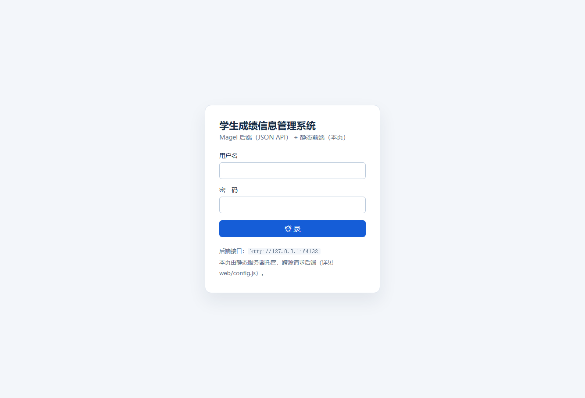
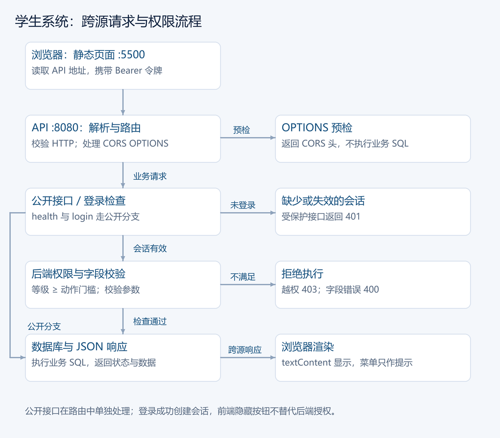
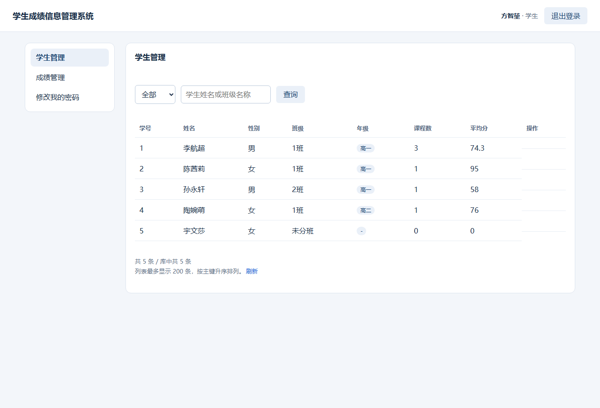
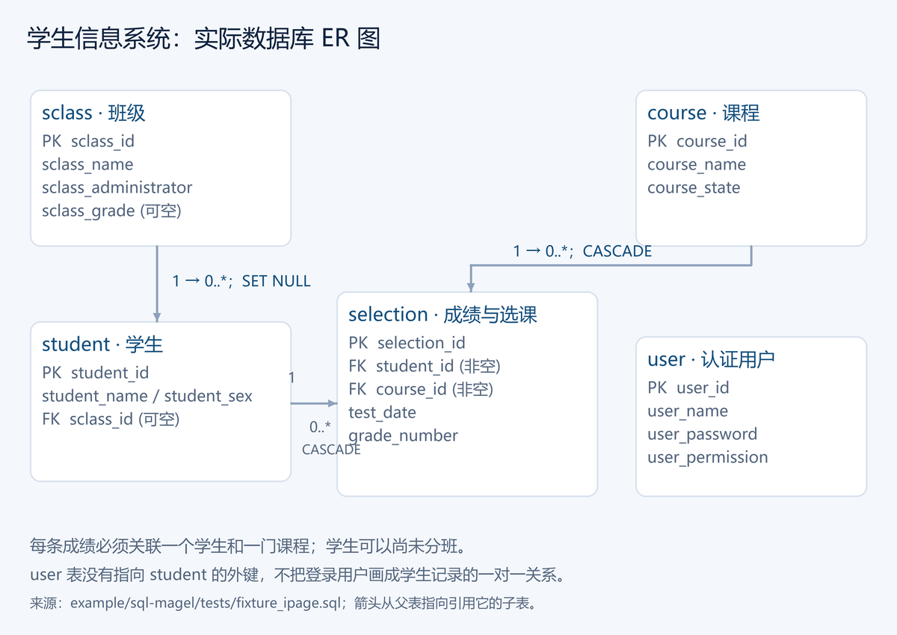
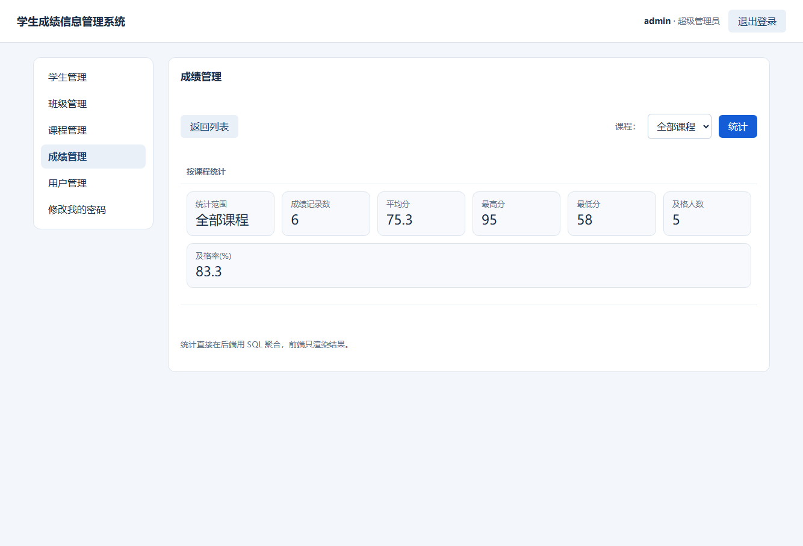

# 第 24 章 学生信息管理系统：前后端分离

第 23 章把业务放在命令行里。这一章把交互搬到浏览器：浏览器负责显示和表单，Magel 负责 HTTP、JSON、权限与数据库。我们直接使用仓库的[前后端分离项目](../../example/sql-magel/example/ipage-student-server/README.md)，不另写一套只有页面的演示。

## 24.1 先找到三个入口

| 入口 | 职责 |
| --- | --- |
| [main.mgl](../../example/sql-magel/example/ipage-student-server/main.mgl) | Magel API 服务、登录会话、路由、业务校验、MySQL 访问 |
| [web/index.html](../../example/sql-magel/example/ipage-student-server/web/index.html) | 页面外壳与登录表单 |
| [web/app.js](../../example/sql-magel/example/ipage-student-server/web/app.js) | 调接口、渲染表格、提交表单 |
| [web/config.js](../../example/sql-magel/example/ipage-student-server/web/config.js) | 后端地址配置 |

一次请求经过浏览器、HTTP API、权限判断和 SQL，结果再以 JSON 返回。前端静态服务器与 API 是两个进程、两个端口；API 的 `/` 返回 404，页面由静态服务器提供。

这个项目使用 MySQL。仓库还有一个更小的 [SQLite Web 示例](../../example/web-students/README.md)，它由同一服务提供页面，适合先练增删改查；本章讲的跨源部署、会话与权限来自前后端分离项目。

## 24.2 准备独立练习数据库

先构建 Magel，并准备能连接的 MySQL 服务及客户端库。MySQL 客户端库路径可用 `MYSQL_LIBRARY` 指定，具体连接方式见 [SQL 示例说明](../../example/sql-magel/README.md)。

仓库内的[练习夹具](../../example/sql-magel/tests/fixture_ipage.sql)包含五张表及四种角色账号。脚本含有删除并重建表的语句，下面明确使用独立数据库 `magel_book_students`；不要把该参数改成已有业务库。

以下命令从 **Magel 仓库根目录**运行。第一个终端启动后端：

```sh
./magel.exe run example/sql-magel/example/ipage-student-server/main.mgl -- --db magel_book_students --mysql-user root --mysql-password 123456 --init example/sql-magel/tests/fixture_ipage.sql --listen-port 8080 --allow-origin http://127.0.0.1:5500
```

将 MySQL 用户与口令替换为本机练习环境的配置。初始化只在缺少业务表时执行；重复练习需要重置数据时，先确认数据库名称，再显式添加 `--reinit`。

第二个终端托管静态页面：

```sh
python -m http.server 5500 --bind 127.0.0.1 --directory example/sql-magel/example/ipage-student-server/web
```

打开 `http://127.0.0.1:5500/`。页面默认访问 `http://127.0.0.1:8080`；后端换端口时，可用查询参数 `?api=http://127.0.0.1:9000` 或修改 `web/config.js`。浏览器页面上的 API 地址可以帮助核对两端是否连接正确。



图中的端口来自自动回归启动时分配的本地端口，不必与手工练习的 5500 和 8080 相同。



## 24.3 先把接口跑通

| 操作 | 接口 | 关注点 |
| --- | --- | --- |
| 健康检查 | `GET /api/health` | 实际执行数据库查询 |
| 登录 | `POST /api/login` | JSON 字段 `userName`、`password` |
| 当前会话 | `GET /api/session` | 返回用户、模块和动作权限 |
| 学生列表 | `GET /api/students` | 返回 `items`、`count`、`total`、`limit` |
| 新增学生 | `POST /api/students` | 教师及以上角色可用 |
| 修改学生 | `PUT /api/students/{id}` | 校验字段和班级关系 |
| 删除学生 | `DELETE /api/students/{id}` | 管理员及以上角色可用 |

登录成功后取得令牌，其余受保护请求使用 `Authorization: Bearer <token>`。令牌存放在后端内存会话表中，后端重启后失效。先看 `Request`、`Response`、`Session` 类型，再沿 `route` 与各模块分发函数阅读，比从两千多行文件的第一行读到底更容易建立调用关系。

浏览器带 Authorization 调用另一个源，会触发 CORS 预检。后端处理 `OPTIONS` 并返回允许的源、方法和请求头；只放行页面所在的来源并不替代登录或权限检查。

## 24.4 权限必须在后端生效

夹具里的学生账号为“方智堃 / zhongli”，超级管理员账号为“admin / 123456”，均仅用于演示数据。学生登录后能看到学生、成绩和修改密码三个入口；看不到新增和删除按钮。



权限等级为学生 0、教师 2、管理员 3、超级管理员 4。`actionNeedLevel` 查询动作门槛，后端按“用户等级大于等于门槛”执行判定。前端读取服务端返回的模块与动作，只负责显示合适的入口。即使手工构造 HTTP 请求，后端仍会拒绝越权动作。

练习时先登录学生，再登录超级管理员，对照同一张学生表的按钮变化。接着尝试直接调用一个权限不足的接口，观察 403，而不能仅凭“按钮不见了”认定权限已经正确。

## 24.5 数据关系与完整操作

| 表 | 作用 | 删除时的关系 |
| --- | --- | --- |
| `user` | 登录用户与角色 | 受用户模块规则约束 |
| `sclass` | 班级 | 删除后学生变为未分班 |
| `student` | 学生 | 删除时级联删除对应成绩 |
| `course` | 课程 | 删除时级联删除对应成绩 |
| `selection` | 选课、考试日期与成绩 | 关联学生和课程 |



ER 图中的 `user` 是认证表，没有指向学生表的外键。`selection` 是学生与课程之间的关联记录，表结构没有把学生和课程组合声明为唯一键；重复录入的拒绝由应用规则执行。

用管理员账号新增一名学生，编辑姓名与班级，按姓名查询，最后删除。再打开成绩模块的按课程统计，核对人数、平均分、最高最低分与及格率。



统计由后端查询数据库产生，页面负责展示。这样浏览器没有加载全部成绩时，也能取得完整统计。删除接口返回级联或脱离关系的计数，确认框可以说明本次操作将影响什么。

输入校验也在后端执行：主键必须为正整数，姓名等文本按数据库字符长度限制，枚举字段只接受约定值。前端用 `textContent` 展示用户数据，避免把姓名当作 HTML。阅读实现时，分别找“表单可用性”“业务校验”“数据库约束”，它们各自解决不同层次的问题。

## 24.6 沿 main.mgl 读完一次请求

现在回到 `main.mgl`，把前面的界面、ER 图与真实代码对应起来。这个文件没有使用 Web 框架，HTTP 协议、会话和业务分发都能在同一文件里找到。建议先读文件末尾的 `main`，再沿函数调用往回追。

### 24.6.1 main：先准备长期状态，再处理短期请求

入口是 `int64 main(List<String> arguments)`。参数循环识别监听地址、端口、MySQL 连接、数据库名称、初始化文件和跨源来源。`decimal` 返回 `Option<int64>`，端口必须在 0–65535 内；它逐字检查十进制数字，并在乘十之前判断是否会超出上限，不把错误输入悄悄变成 0。

参数读取完成后，`main` 创建一个 `App app`。`App` 把数据库连接、`List<Session>` 会话表、随机状态和 `allowOrigin` 集中在一起，生命周期覆盖整个服务。`connect` 建立 MySQL 连接、设置 `utf8mb4`、选择数据库；`ensureSchema` 判断业务表是否就绪，必要时读取初始化 SQL。失败路径调用 `app.stop()` 关闭连接并返回。

随后才创建 `TcpListener`。当配置端口为 0 时，必须用 `listener.localPort()` 取得系统实际分配的端口；就绪文件写入的也是这个值，测试客户端据此连接。主循环的核心代码如下，摘自实际入口：

```magel
while (maximum == 0 || handled < maximum)
{
    TcpSocket socket = listener.accept((int32)1000);
    if (!socket.isOpen())
    {
        continue;
    }
    Request request = readRequest(&socket, actualPort);
    Response response = route(&app,&request);
    bool sent = sendResponse(&socket,&response, app.allowOrigin);
    socket.close();
    handled = handled + 1;
}
```

每条连接依次经过接收、路由、发送、关闭。`maximum` 为 0 时持续服务，正数用于确定性测试；请求处理完毕才增加计数。当前代码把发送结果保存为 `sent`，但没有重试发送失败的响应。循环退出后，入口再关闭监听器并调用 `app.stop()`。

注意两个寿命：`App` 和监听器存在于循环外，单次请求的 `socket`、`request`、`response` 存在于循环内。这样下一次请求可以继续使用数据库和会话，但不会共享上一条请求的临时正文。

### 24.6.2 Request 与 readRequest：TCP 字节不等于完整 HTTP 请求

`Request` 保存解析后的方法、路径、查询串、正文、媒体类型、Authorization 以及解析状态；`Response` 只保存状态码、媒体类型和正文。把协议层结果集中成值对象后，业务函数就不必再次切分原始报文。

`readRequest` 首先循环调用 `socket.receive(4096)`，把数据追加到 `raw`，直到找到 `\r\n\r\n`。一次 TCP receive 可能只取得半个请求头，也可能同时带回部分正文，所以不能用“一次 receive 就读完一个请求”的假设实现 HTTP。

请求头结束后，函数拆分请求行，校验 HTTP/1.0 或 HTTP/1.1，分离 `path` 与 `query`，再逐行检查头部。它拒绝重复 Content-Length、非法 Host、不支持的 Transfer-Encoding 和 Expect；POST/PUT 缺少 Content-Length 时返回 411。随后继续接收，直到正文达到声明长度，再按该长度截取。

这些失败不会直接执行 SQL，而是写入 `request.status`。`route` 开头看到非零状态，就生成对应的错误响应。协议层与业务层因此只有一个明确交接点。

这仍是有边界的示例：请求头与正文有上限，连接逐条处理；`accept` 的等待时间不等于已接收连接具有完整的读超时。一个迟迟不发完正文的客户端仍可能阻塞后续请求，不能把这段循环描述成并发 HTTP 服务。

### 24.6.3 route：先处理公开入口，再查会话

`route(App mut& app, Request const& request)` 的参数说明了职责：它可能改变应用的会话状态，但只读取本次请求。代码的先后顺序很重要：

1. 请求解析失败：立即生成错误响应。
2. OPTIONS：直接生成预检响应。
3. GET `/api/health`：执行 `SELECT 1`，确认数据库实际可用。
4. `/api/login`：只允许 POST，并调用 `app.login`。
5. 非 `/api/` 路径：返回 404，明确告诉调用方静态页面由另一个服务器提供。
6. 其余 API：提取 Bearer 令牌、查找会话，然后按资源分发。

核心的会话检查只有两行：

```magel
Session session = app.findSession(bearerToken(request.authorization));
if (!session.valid)
{
    return errorResponse(401, "未登录或会话已失效，请重新登录");
}
```

`bearerToken` 检查 Bearer 前缀，`findSession` 在 `App.sessions` 中查找令牌，找不到时返回 `valid=false` 的会话值。登录函数在核对用户名和口令之后创建会话，并把令牌、用户信息和可见模块树一起返回。注销则删除会话表里的对应记录，所以后续使用旧令牌的请求会失败。

`issueToken` 使用应用的随机状态生成 64 个十六进制字符。阅读代码时，应把“令牌字符串长度”与“密码学安全性”分开；这个练习项目不因此具备完整的生产认证方案。

### 24.6.4 dispatchStudents 与 allow：路由不直接等于业务授权

通过会话检查后，`splitResource` 把 `/api/students` 与后续资源部分分开，交给 `dispatchStudents`。它进一步同时判断资源尾段和 HTTP 方法。例如，根资源的 GET 是列表，POST 是新增；`/{id}` 的 PUT 是修改，DELETE 是删除；`/query` 只接受 POST。

下面是实际的列表与新增分支摘录：

```magel
if (request.method == "GET")
{
    if (!allow(session.level, "student", "list",&denial))
    {
        return denial;
    }
    return app.listStudents("", "");
}
if (request.method == "POST")
{
    if (!allow(session.level, "student", "add",&denial))
    {
        return denial;
    }
    return app.createStudent(&request);
}
```

同一个资源，动作不同，权限门槛也不同。`allow` 先通过 `actionNeedLevel` 查权限表；动作不存在属于服务端配置错误，返回 500；当前等级不足则生成 403；通过后才调用业务方法。前端隐藏“新增”按钮只是界面提示，真正挡住直接 HTTP 请求的是这里。

班级、课程、成绩和用户模块采用相同的分发结构，但业务规则并不完全相同。例如，成绩有统计动作，用户模块还有重置口令与修改权限，不能只复制学生路由然后替换表名。

### 24.6.5 JSON、SQL 与结果封装：新增和查询各追一遍

新增学生时，`createStudent` 调用 `readJsonBody`，先确认媒体类型为 `application/json`，再解析正文。`textField` 读取字符串并 trim；`intField` 要求真正的 JSON 整数，类型不符或越界时给失败哨兵值。函数把需要的字段保存为独立的 String／整数后，关闭 JSON 根对象，再校验姓名、性别和班级关系。

这个顺序同时展示了 Magel 的值语义和资源边界：临时 JSON 文档结束后，已经取得的值仍可用于 SQL；不能把借用文档内部对象的短命引用直接保存出去。阅读失败分支时，也要检查 `root.close()` 是否在应有位置执行。

SQL 值通过当前数据库连接的 `db.quote(...)` 转义。比如登录查询把姓名和口令作为值拼入固定 SQL，查询学生时也是在已知语句骨架上追加经过处理的条件。`quote` 处理的是值，不是任意表名和列名；启动参数里的数据库名称属于另一类配置输入，不能把它与浏览器传来的字段混为一谈。

列表查询可以从 `studentListSql` 开始读：

```magel
" FROM student st"
" LEFT JOIN sclass cl ON cl.sclass_id = st.sclass_id"
" LEFT JOIN selection se ON se.student_id = st.student_id"
```

LEFT JOIN 让“尚未分班”和“尚无成绩”的学生仍然出现在列表里。`COUNT(se.selection_id)` 统计实际成绩记录；换成 COUNT(*) 会把连接产生的空行也算进去。平均分使用 AVG、ROUND 和 IFNULL，`studentGroupSql` 补齐 GROUP BY 与排序，避免在 ONLY_FULL_GROUP_BY 模式下依赖不确定的分组行为。

执行结果由 `ResultSet` 承接，先检查 `rows.ok`，再读取行列。`studentRow` 把一行转成 JSON 对象，字符串经过 `jsonString` 处理；`listEnvelope` 最后补上 `items`、`count`、`total` 和 `limit`。因此页面既能显示当前返回多少行，也知道服务端列表上限。

### 24.6.6 sendResponse：统一协议出口，再回到浏览器

路由函数返回 `Response` 后，`sendResponse` 才负责写 HTTP 状态行、Content-Type、按 UTF-8 字节计算的 Content-Length、CORS 头和 `Connection: close`，最后追加正文。浏览器接到响应，按状态码决定显示数据还是错误信息，并用 `textContent` 把用户字段放进页面。

CORS 响应头让浏览器决定是否允许页面读取跨源响应，它不取代 Bearer 会话与后端权限。OPTIONS 不执行业务 SQL；真正的数据请求仍要重新走身份和动作检查。

现在可以拿一条操作自己追踪：登录管理员，点击“新增学生”，在浏览器网络面板中找到 POST `/api/students`，然后按 `readRequest → route → dispatchStudents → allow → createStudent → sendResponse` 对照源码。故意省略姓名、使用学生令牌或提交不存在的班级，分别观察字段校验、权限校验和关系校验在哪一步返回。

## 24.7 验收与交付

项目已经提供两类回归，使用独立测试库；在准备好 MySQL 的机器上运行：

```sh
python tests/magel_ipage_student_server.py --backends run
python tests/magel_ipage_student_server_browser.py --browser "C:/Program Files (x86)/Microsoft/Edge/Application/msedge.exe"
```

接口回归覆盖登录、角色权限、五模块业务、统计与 HTTP 边界；浏览器回归真正从不同源访问 API，检查菜单、增删改查和 HTML 注入防护。本章截图来自该真实浏览器回归，数据来自仓库夹具。

后端可通过 AOT 交付：

```sh
./magel.exe aot example/sql-magel/example/ipage-student-server/main.mgl --out build/student-server.exe
```

AOT 默认 checked 和 O3。前端目录仍单独部署，MySQL 服务与客户端依赖也需要准备；不能因为后端生成了可执行文件，就认为数据库与页面已经一并打包。

该示例沿用练习数据中的明文口令，会话没有到期与刷新机制，前端的登录尝试次数也不构成服务端限流。正式服务需进一步完善认证、会话、TLS、SQL 参数绑定、超时及并发；本章的目标是把现有应用的职责与请求链路讲清楚。

下一章进入另一个宿主：[单片机上的 Magel 解释器](25-单片机解释器.md)。
