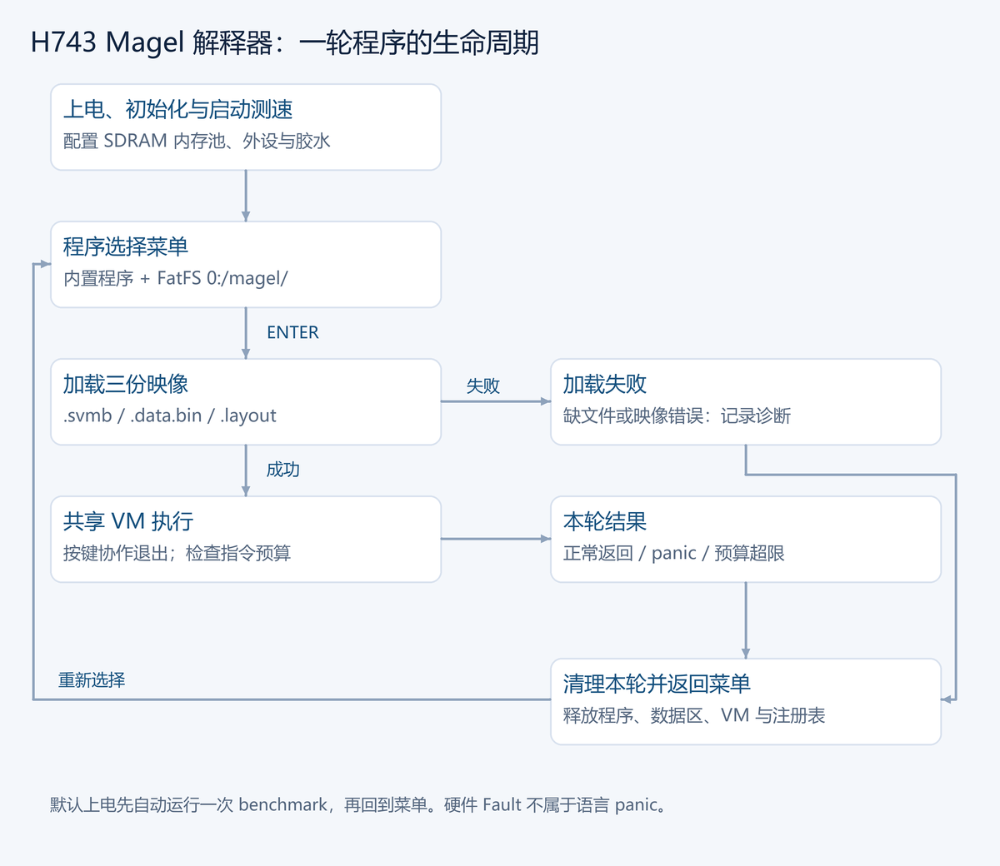

# 第 25 章 单片机上的 Magel 解释器

桌面项目把程序交给操作系统运行，单片机需要自己提供启动、内存、文件和外设。仓库已经有一套 [FK-STM32H743XIH6 板端工程](../../example/mcu/FK-STM32H743XIH6/README.md)：LCD 选择程序，FatFS 读取映像，按键控制运行，串口输出诊断。

本章按实际工程追踪一次“生成程序、加载执行、出错恢复”的过程。硬件与工具链的完整参数以板级 README、CMake 和源码为准。

## 25.1 单片机上解释的是什么

宿主机上的 Magel 编译器负责解析源码、检查类型与借用、优化四元式，最后导出 `.svmb`。板端读取字节码、数据区与布局信息，由共享 VM 执行；板端没有携带整套源码解析器，也不在运行时编译 C++。

```text
桌面：.mgl → 解析与检查 → 优化四元式 → .svmb / .data.bin / .layout
板端：加载三份文件 → 配置内存与胶水 → VM 执行 → 清理本轮状态 → 返回菜单
```

| 源码入口 | 阅读重点 |
| --- | --- |
| [library/stackvm](../../library/stackvm/) | 桌面与板端共同的 VM 核心 |
| [source/stackvm_mcu](../../source/stackvm_mcu/README.md) | 裁剪配置、静态池和宿主适配 |
| [板端 main.c](../../example/mcu/FK-STM32H743XIH6/main.c) | 上电后的独立程序入口 |
| [magel_board.cpp](../../example/mcu/FK-STM32H743XIH6/magel_board.cpp) | 加载、菜单、执行与原生接口注册 |
| [programs/board.mgl](../../example/mcu/FK-STM32H743XIH6/programs/board.mgl) | Magel 可调用的外设函数签名 |

板级 SDK 副本位于工程的 `sdk/`，不依赖原来的小车工程目录。共享 VM 不维护第二份实现，宏决定哪些能力编入固件。

## 25.2 先分清三类内存

真实 H743 工程从 SDRAM 分配如下三块区域：

| 区域 | 当前板级预算 | 存放内容 |
| --- | ---: | --- |
| 元数据 | 2 MiB | C++ 元数据分配、解码辅助与宿主对象 |
| 运行时 Arena | 16 MiB | VM 容器、执行状态与运行时对象 |
| 字节池 | 4 MiB | 程序分配、字符串与字节存储 |

总计 22 MiB，来自参考板的外部 SDRAM 配置，不代表只有少量 SRAM 的 MCU 也能直接使用。硬件容量变化时，需要同时核对 BSP 布局、链接脚本和三项预算。

板端关闭异常、RTTI、OS 线程、AOT 和大数，默认关闭反射，保留共享核心支持的执行优化。关闭 OS 线程不等于关闭协作式协程；具体标准库是否能用，还取决于模块门禁和宿主注册。

## 25.3 写一个可退出的 LCD 程序

在 `programs/` 下创建练习源码，或使用 include 搜索路径找到 `board.mgl`：

```magel
%include "board.mgl"

void main() {
    lcdClear(0);
    lcdText(8, 8, "Hello Magel", 65535, 0);
    while (!boardExitRequested()) {
        if (keyClicked(2)) {
            lcdFill(8, 40, 100, 20, 2016);
        }
        boardDelay(10);
    }
}
```

`boardExitRequested()` 让程序协作响应 MODE/ENTER 退出。键号为 0=MODE、1=ENTER、2=UP、3=DOWN，颜色为 RGB565。`boardDelay` 的中断继续运行，程序也需要留出检查退出与输入的机会。

这是板端程序，需要相应胶水，不能直接在普通桌面 VM 中调用 LCD 函数。编译时指定板端关闭的反射配置：

```sh
./magel.exe svmb example/mcu/FK-STM32H743XIH6/programs/hello.mgl --no-reflection --out build/mcu-hello
```

上例命令使用仓库已有的 `hello.mgl`；若保存了自己的练习程序，替换源路径并添加对应 include 目录即可。三份输出必须使用同一个前缀。

## 25.4 从 Magel 签名到原生外设

`board.mgl` 声明函数类型，`magel_board.cpp` 的 `RegisterBoard` 使用原生注册表绑定名字、参数数量和回调，例如 `lcdClear` 对应一个参数。回调读取 `NativeCallContext`，检查坐标、颜色、文本和键号，再交给 BSP。

这里的分工很明确：Magel 负责程序逻辑，VM 负责执行与错误传播，胶水负责参数边界，BSP 负责具体硬件。新增外设时，应同时维护 Magel 签名、回调、注册参数数量与错误行为。

LCD 文本当前支持可打印 ASCII，不能把桌面字符串支持 UTF-8 等同于板上字体已经支持中文。串口为 USART1、PA9/PA10、115200 8N1；`println` 和 VM 诊断通过该宿主输出。

## 25.5 构建、加载与菜单

完整构建命令见[板级构建说明](../../example/mcu/FK-STM32H743XIH6/README.md#构建)。需要 CMake、Clang/LLVM、Make 和 Cortex-M7 硬浮点 Arm C/C++ 运行库；仓库提供运行库获取脚本。默认 SDK 来自本工程 `sdk/`，构建输出位于 `build-local/board-sdk/`。

程序加载使用 FatFS 的 `0:/magel/`。参考 BSP 中的 `0:` 对应外部 W25QXX 卷，不是自动识别任意 SD 卡。把每个程序的三份文件放在同一目录：

```text
0:/magel/hello.svmb
0:/magel/hello.data.bin
0:/magel/hello.layout
```

单个部署文件上限为 1 MiB。缺文件或映像损坏时，显示失败并返回菜单，不悄悄运行另一份程序。菜单最多 32 项，包含内置测速、正常退出、故意 panic 三个入口。

默认上电自动运行一次 benchmark，完成后进入按键演示，再返回菜单。UP/DOWN 选择，ENTER 运行，MODE 重新扫描。若想上电直接显示菜单，构建时使用 `-DFK_AUTORUN_BENCHMARK=OFF`。



## 25.6 把五个源码入口串起来

前面的表格是定位地图，下面才是代码的调用关系。读这一套工程时，不要把“共享核心”“桌面 MCU 宿主”和“真实板级入口”当成三个不同的解释器：它们围绕同一个 `stackvm::Machine` 组合出不同的宿主。

### 25.6.1 library/stackvm：程序、数据与执行器分开

先看 `stackvm.hpp` 的几个公开类型。`Program` 保存加载后的程序与执行元信息，`DataArea` 保存数据及布局，`NativeRegistry` 按名字和参数数量登记宿主函数，`Machine` 才是执行状态与运行时服务的入口。`RunResult` 把成功状态、诊断、执行步数等结果交还宿主。

`loadProgramBinary` 把 `.svmb` 解码为 `Program`，`DataArea::loadFromBytes` 把数据字节和 layout 组合为运行时数据区。二者可以分别失败，所以板端 `Execute` 给它们安排了独立诊断和返回码，不等到第一条程序指令执行时才猜测“是不是文件读错了”。

`Machine::run` 使用共享的执行核心及其默认优化。源码解析、类型检查和四元式优化已经在桌面编译阶段完成；这里不会再次解释 `struct`、展开泛型或调用 AOT 编译器。想追具体指令的执行，再从 `stackvm.cpp` 包含的执行模块继续进入寄存器核心与执行准备逻辑。

这层不应直接知道 LCD 型号或 W25QXX 引脚。它通过字节堆、文件 API、输出下沉与原生注册表接收宿主能力，才能同时用于桌面和板端。

### 25.6.2 source/stackvm_mcu：把桌面服务替换为有预算的宿主

`mcu_host.cpp` 是可在桌面运行的 MCU 配置验证入口。它读取映像、安装内存池、挂接输出和原生胶水，再运行同一份字节码。它方便检查裁剪构建、程序结果和软重启，不能由此推断真实 LCD、串口或 SDRAM 已经验证。

把这一目录按职责拆开读会更清楚：

| 文件 | 要解决的具体问题 |
| --- | --- |
| `mcu_arenas.cpp/.hpp` | 安装元数据、运行时 Arena 与程序字节池，提供当前池与水位 |
| `mcu_metadata_heap.cpp` | 为 C++ 元数据分配接入有预算的存储 |
| `mcu_glue.cpp` | 注册板端基础转换、文本输出等原生函数，并挂接输出下沉 |
| `mcu_filesystem.hpp`、`mcu_file_api.cpp` | 把 VM 文件操作交给宿主文件系统 API |
| `mcu_console.hpp` | 输入回调约定，供桌面 stdin 或板上串口实现 |

`InstallRuntimeArena()` 把 `Memory::` 容器接到指定 Arena，因此应在构造使用这些容器的运行状态之前安装。板级代码先注入元数据与运行时池，安装分配器，再构造字节池的身份索引；顺序变化可能让长期对象先分配到错误的池。

`mcuGlue::Register(machine, &registry)` 把基础胶水注册到指定表，再通过 `machine.setNativeRegistry` 交给机器。输出经 `setOutputSink` 下沉到宿主，`keepText=false` 时不必把整轮输出积累在 RAM，串口可在运行过程中持续收到文本。

### 25.6.3 板端 main.c：先让硬件能支撑 C++ 宿主

真实板端的 `main.c` 先关闭中断，配置 MPU、Cache、HAL、系统时钟和 DWT，再初始化定时器、SDRAM、内存管理、串口与按键。打开中断后，输出启动标记，初始化 LCD 与 W25QXX，最后调用 `Magel_BoardRun()`。

这段顺序解释了为什么不能一上电就创建大容量 VM 容器：外部 SDRAM 与管理器此时还没有就绪。早期少量静态构造的分配由工程明确配置的启动堆承担，之后才切换到外部池。

主入口没有启动电机、舵机和小车任务。`TIM6_DAC_IRQHandler` 提供时基并驱动按键消抖；`TIM7_IRQHandler` 只确认参考工程创建的中断。读者修改固件时，应保留这些服务之间的边界，不能因为 SDK 中存在驱动就认为相关任务正在运行。

### 25.6.4 magel_board.cpp：菜单拥有宿主，Execute 拥有一轮程序

`Magel_BoardRun` 从 BSP 的外部堆申请三块池，注入元数据与运行时分配器，然后设置字节池、挂载 FatFS、扫描程序并绘制菜单。挂载只尝试读取已有卷，不在失败时格式化介质。

菜单循环维护 `selected`、`run` 和 `lastStatus`。UP/DOWN 改变选择，MODE 重扫，ENTER 把 `run` 设为真；真正运行发生在下一轮的 `Execute(entries[selected])`。默认启动测速与自检配置也通过这些状态进入执行路径，而不是再维护一套 VM 入口。

`Execute` 的前半段决定映像来源。内置程序直接引用 Flash 中的指针与长度，外部程序则按同一文件名前缀读取三份 FatFS 文件。`ReadFile` 检查 1 MiB 上限、实际读取长度和关闭结果；只要一份失败，就返回错误，不偷偷切回内置程序。

解码 `Program`、加载 `DataArea` 后，实际绑定与执行代码如下，摘自工程：

```cpp
stackvm::NativeRegistry registry;
stackvm::Machine machine;
machine.setHeapAllocator(&mcuArenas::CurrentBytePool());
machine.setData(&data);
machine.setFileApi(&mcuFilesystem::CurrentApi());
mcuGlue::SetOutput(SerialWrite, nullptr, false);
mcuGlue::Register(machine, &registry);
RegisterBoard(registry);
mcuConsole::SetRead(SerialRead, nullptr);
const auto result = machine.run(program, {}, 10000000u);
```

这里先挂基础胶水，再追加板级接口，两者使用同一个注册表。注册表、数据区和字节池必须在 `run` 期间有效；`registry` 比 `machine` 更早构造，退出作用域时也会更晚析构。字节池是宿主长期提供的对象，不能拿临时池的地址交给机器。

`Execute` 对读文件、字节码解码、数据加载和执行失败分别返回 2、3、4、5，成功返回 0。菜单接到返回值后记录状态、输出三类池的峰值、清理按键事件并重新绘制界面，因此“运行结束”与“回到可操作菜单”是同一条可追踪路径。

程序、数据区、Machine 和本轮注册表都在 `Execute` 返回前析构。承载 C++ 静态对象的元数据池却不能直接整块重置，否则仍存在的静态对象会保存失效地址；源码特别保留了这一点。恢复一轮 VM 与清空全部 SDRAM 是不同操作。

### 25.6.5 board.mgl 与 RegisterBoard：名字和实参数量必须对齐

`board.mgl` 是 Magel 一侧的宿主函数声明，例如：

```magel
void lcdClear(int64 color);
bool boardExitRequested();
void boardDelay(int64 milliseconds);
```

它们没有 Magel 函数体，编译器按声明检查调用。执行时，`RegisterBoard` 把同名符号绑定到 C++ 回调：

```cpp
registry.add("lcdClear", 1, LcdClear);
registry.add("boardExitRequested", 0, BoardExitRequested);
registry.add("boardDelay", 1, BoardDelay);
```

声明、名字、参数个数、参数含义和返回值必须同时一致。只在 `board.mgl` 增加声明不会凭空产生硬件能力；只增加 C++ 回调却没有注册，也不能按名字调用。

回调通过 `NativeCallContext` 读取参数并执行范围检查，再调用 BSP。比如 LCD 要检查颜色与坐标，按键要检查键号。板端禁用 C++ 异常，失败应写入原生调用的错误状态，让 VM 返回失败结果；不能在这里抛异常并期待菜单捕获。

最后沿一个调用自己追一遍：Magel 程序调用 `lcdClear(0)`，编译器产生宿主调用，VM 查 `NativeRegistry` 找到 `LcdClear`，回调取整数、检查范围，再调用 LCD 桥接函数。`println` 则走基础输出下沉到 `SerialWrite`。同一套程序逻辑由不同胶水连接到不同宿主，这正是共享核心能够上板的原因。

## 25.7 验证退出与错误恢复

依次验证：正常返回、主动退出、语言 panic、VM 指令预算超限、缺少数据文件。每轮应释放程序、数据区、VM 与注册表，并回到选择页；默认每轮预算为 10,000,000 条 VM 指令。

硬件 Fault、原生 C/C++ 越界或不可恢复的分配器耗尽不属于语言 panic，不能据此承诺任何错误都能恢复菜单。读代码时应区分 VM 的失败返回和 CPU 的硬件异常。

没有板子时，可先使用桌面上的独立 MCU 宿主回归：

```sh
python tests/mcu_vm.py --magel magel.exe
python tests/mcu_fk_controls.py
python example/mcu/FK-STM32H743XIH6/tools/verify_sdk.py
```

MCU 宿主回归使用其定义的测试预算，检查裁剪构建、异常符号与选定字节码执行；它不替代 LCD、按键、串口和 SDRAM 的实机测试。板级 README 保留真实硬件的原始测速与恢复记录，历史数据应保留原日期和配置。

做到这里，项目的主线就完整了：同一套语言和 VM 语义，桌面负责生成映像，板端提供受预算约束的宿主，用原生接口接入硬件，并在每轮程序结束后恢复可操作状态。
